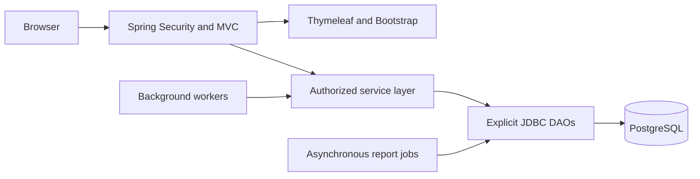

# TelecomOSS

## Telecom Service Assurance & Trouble Ticket Management System

TelecomOSS helps a telecom support team turn customer issues and simulated network
incidents into traceable trouble tickets. It connects customer support, engineer
assignment, incident resolution, SLA monitoring and management reporting in one
Java web application.

**Java 8 · Spring Boot 2.7.18 · PostgreSQL · Spring JDBC · Thymeleaf · Bootstrap**

[Documentation index](docs/README.md) · [Setup and demo](docs/DEMO.md) ·
[System design](docs/design/README.md) · [User workflows](docs/WORKFLOWS.md)

## Contents

1. [Overview](#overview)
2. [Features](#features)
3. [Users and responsibilities](#users-and-responsibilities)
4. [Technology stack](#technology-stack)
5. [System design](#system-design)
6. [Ticket workflow and SLA rules](#ticket-workflow-and-sla-rules)
7. [Reports](#reports)
8. [Getting started](#getting-started)
9. [Testing and verification](#testing-and-verification)
10. [Project structure](#project-structure)
11. [Documentation map](#documentation-map)
12. [Current scope](#current-scope)

## Overview

A telecom operator supports mobile, broadband, enterprise connectivity, VPN and cloud
connectivity services. When an outage, slow connection or other service issue occurs,
the support team needs to know who owns the service, who is investigating, how much
SLA time remains and whether the incident needs escalation.

TelecomOSS provides that operational flow:

- Customers raise and track issues against their own services.
- Service desk staff triage tickets, assign engineers and coordinate closure.
- Engineers acknowledge incidents, investigate and record structured resolutions.
- Managers monitor service assurance metrics and generate reports.
- Background workers evaluate SLA deadlines, process notifications and recover
  persisted network events.

The project is a **server-rendered modular monolith**. Business operations use
explicit parameterized SQL through `JdbcTemplate` and Spring-managed transactions.
Database access does not use JPA or Hibernate.

## Features

| Area | Implemented behavior |
|---|---|
| Authentication | Password + CAPTCHA + OTP, password reset, account locking, login history and role-based sessions |
| Customers and services | Own-service views, active-service ticket intake, staff customer lookup |
| Ticket tracking | Status/priority filters, pagination, ticket details, complete status history and optimistic version checks |
| Assignment | Up to three eligible engineer recommendations based on skill, region, availability, workload and experience |
| Resolution | Acknowledgment, customer-wait/resume, root cause, resolution code/text, desk closure, cancellation and one-time feedback |
| SLA | Separate response/resolution deadlines, warning thresholds, remaining time and priority changes based on original creation time |
| Escalation | Three automatic levels, immutable escalation history and explicit resumption of the recorded operational state |
| Notifications | Recipient inboxes, independent read state, durable in-app delivery receipts and bounded retries |
| Network events | Node/service mappings, development simulation, automatic ticket fan-out, replay protection and restart recovery |
| Dashboards and reports | Four role-scoped dashboards and seven asynchronous CSV/TXT reports |

## Users and responsibilities

| User | Main responsibility | Dashboard |
|---|---|---|
| Customer | Raise issues, track own tickets, read notifications and submit feedback | `/customer/dashboard` |
| Service desk | Create tickets for customers, assign/reassign, update priority, resume escalation, close/cancel and review events | `/service-desk/dashboard` |
| Network engineer | Work on currently assigned tickets, acknowledge, investigate and resolve | `/engineer/dashboard` |
| Network manager | Review global operational/SLA metrics, escalation notifications and reports | `/manager/dashboard` |

Customer access follows service ownership. Engineer access follows the **current**
assignment. Report jobs belong to their requesting staff user and role.

See [role workflows and permission matrix](docs/WORKFLOWS.md) for step-by-step journeys.

## Technology stack

| Layer | Technology | Purpose |
|---|---|---|
| Language | Java 8 | Domain logic, Streams, time API and concurrency |
| Framework | Spring Boot 2.7.18 | Application configuration, embedded web server and dependency management |
| Web | Spring MVC + Thymeleaf | Controllers, form binding and server-rendered HTML |
| UI | Bootstrap 5.3.3 through WebJars | Responsive layout, forms, tables and navigation |
| Security | Spring Security + BCrypt | Session authorization, CSRF and password hashing |
| Persistence | Spring JDBC / `JdbcTemplate` | Explicit SQL, row mapping and transactions |
| Database | PostgreSQL; verified locally with PostgreSQL 18 | Relational storage, constraints, indexes, row locks and mutation guards |
| Build | Maven 3.9.x | Dependency management, tests and runnable JAR packaging |
| Background work | Java `ExecutorService`, `ScheduledExecutorService`, `BlockingQueue`, `PriorityQueue`, `Callable`/`Future` | Event processing, SLA monitoring, notifications and report jobs |
| Validation | Bean Validation | Server-side form constraints |
| Testing | JUnit 5, Mockito, AssertJ, MockMvc and disposable PostgreSQL instances | Unit, MVC, transaction, concurrency and database verification |

Spring-managed library versions are defined by the Boot parent in [pom.xml](pom.xml).

## System design



Controllers bind forms and navigate. Services enforce permissions and business
rules. DAOs execute bound SQL. Ticket changes, history, notifications and audit
records commit or roll back together.

Explore the design:

- [System context, layers and deployment](docs/design/README.md)
- [Domain and application class diagrams](docs/design/CLASS_DIAGRAMS.md)
- [Database ER diagrams and migration history](docs/design/DATABASE.md)
- [Ticket state, authentication and processing sequence diagrams](docs/design/SEQUENCES.md)
- [Architecture decisions and operating limits](docs/ARCHITECTURE.md)

## Ticket workflow and SLA rules

The standard journey is:

**Customer raises → Desk assigns → Engineer acknowledges/investigates → Engineer
resolves → Desk closes → Customer submits feedback.**

During investigation, an engineer may request customer information and later resume.
SLA clocks continue while the ticket is `PENDING_CUSTOMER`.

Initial seeded SLA policies:

| Priority | Response target | Resolution target |
|---|---|---|
| CRITICAL | 15 minutes | 2 hours |
| HIGH | 30 minutes | 4 hours |
| MEDIUM | 2 hours | 12 hours |
| LOW | 8 hours | 48 hours |

Policies are immutable and versioned. Each ticket stores the selected policy version.
A desk priority change selects the new priority's latest policy and recalculates
both deadlines from the ticket's **original creation time**.

The monitor evaluates active tickets every 60 seconds:

1. **Team Lead:** an unfinished target reaches its warning threshold, initially 80%.
2. **Network Manager:** an unfinished response or resolution target breaches.
3. **Operations Manager:** resolution is overdue by one extra resolution-SLA duration.

Each escalation level is recorded once per ticket. `ESCALATED` retains its prior
operational state; service desk explicitly resumes that state before normal work
continues. Completion at the deadline is on time. Resolved, closed and cancelled work
does not trigger new automatic escalation.

See [ticket lifecycle](docs/LIFECYCLE.md) and [SLA rules](docs/SLA_MONITORING.md).

## Reports

Service desk and network manager users can generate:

| Report | Main question answered |
|---|---|
| Ticket Volume | How many tickets were created, by day, priority and current status? |
| SLA Compliance | Were response and resolution targets met independently? |
| Engineer Performance | What work and completed resolutions belong to each current assignee? |
| Incident Category | Which incident categories occur most often? |
| Regional Incident | How are incidents distributed across service regions? |
| Average Resolution | How long do completed resolutions take, alongside unresolved/overdue counts? |
| Critical Incident | Which critical tickets need review? |

Reports run in a bounded background pool. Users request a job, inspect its status and
download CSV or quoted tab-separated TXT after completion. Downloads enforce job
ownership and protect spreadsheet formula prefixes.

[Report definitions, date semantics and limits](docs/REPORTS.md) ·
[Synthetic CSV sample](docs/samples/synthetic-incidents.csv) ·
[Synthetic TXT sample](docs/samples/synthetic-incidents.txt)

## Getting started

### Prerequisites

- Java **8 JDK**, Maven 3.9.x and PostgreSQL.
- A dedicated database and a database login allowed to install its schema.
- PowerShell for the supplied Windows setup/test helpers.
- PostgreSQL CLI tools on `PATH` when using disposable integration-test helpers.

Clone this repository and run commands from its root. The Windows Maven helper
selects Java 8 without changing global `JAVA_HOME`.

### Configure the database

```powershell
Copy-Item config/application-local.properties.example config/application-local.properties
```

Enter your own datasource settings in that local file. It is ignored by Git and
kept outside the application JAR. Alternatively, use `SPRING_DATASOURCE_URL`,
`SPRING_DATASOURCE_USERNAME` and `SPRING_DATASOURCE_PASSWORD` environment variables.
Never place real passwords in shared documentation or command-line arguments.

### Initialize a fresh database

For an **empty dedicated database**, install fixtures, upgrade the schema and provision
the demonstration users:

```powershell
.\scripts\Initialize-Database.ps1 -Seed
.\scripts\Update-Database.ps1 -DevAccounts
```

The migration runner supports **V001–V008**. Initial random demo passwords are written
to the ignored `config/dev-accounts.properties` file.

For an already initialized database, apply only pending migrations:

```powershell
.\scripts\Update-Database.ps1
```

Initialization refuses an occupied schema. Normal application startup does not run
schema migrations. See [database setup](db/README.md) for details.

### Run the application

```powershell
.\scripts\mvn.ps1 spring-boot:run '-Dspring-boot.run.profiles=dev'
```

Open [http://localhost:8080/login](http://localhost:8080/login).

| Demo username | Role |
|---|---|
| `customer.demo` | Customer |
| `desk.demo` | Service desk |
| `engineer.demo` | Network engineer |
| `manager.demo` | Network manager |

Use the password from your local provisioning file. Answer the displayed CAPTCHA,
then enter the six-digit development OTP shown on step 2 in the same browser session.

**IntelliJ:** select the shared **TelecomOSS Dev** configuration, use Java 8, keep the
project root as working directory and set `--spring.profiles.active=dev`.

**Runnable JAR:**

```powershell
.\scripts\mvn.ps1 package
java -jar target/telecom-assurance-0.0.1-SNAPSHOT.jar --spring.profiles.active=dev
```

For the full installation and multi-role demo, use [the setup/demo guide](docs/DEMO.md).

## Testing and verification

| Command | Purpose |
|---|---|
| `.\scripts\mvn.ps1 test` | Unit tests; does not require a database |
| `.\scripts\Test-DaoIntegration.ps1` | DAO mapping tests in a disposable PostgreSQL instance |
| `.\scripts\Test-AuthIntegration.ps1` | Full security, workflow, reports and database suite in disposable databases |
| `.\scripts\mvn.ps1 '-Dtelecom.integration=true' '-Dtest=DatabaseSchemaIntegrationTest' test` | Read-only inspection of the configured development database |
| `.\scripts\Verify-Delivery.ps1` | After packaging: inspect JAR, generate samples and smoke-test a separate read-only app instance |

The last full implementation verification on **16 October 2026** recorded
**214 passing tests, one intentional opt-in skip, four passing live read-only checks
and a passing packaged Java 8 smoke test**. These are recorded results, not a live CI badge.

See [assessment and test evidence](docs/ASSESSMENT.md) and [milestone records](MILESTONES.md).

## Project structure

```text
TelecomOSS/
├── src/main/java/com/amdocs/telecom/
│   ├── controller/   # MVC routes and view models
│   ├── service/      # Authorization, business rules and background work
│   ├── dao/          # Read interfaces, explicit JDBC implementations and mappers
│   ├── model/        # Immutable domain snapshots and controlled enums
│   ├── dto/          # Validated forms and paging/job inputs
│   ├── security/     # Sessions, CAPTCHA, OTP and account rules
│   ├── config/       # Spring, time and executor configuration
│   ├── report/       # Report catalog, query/format factories and exports
│   ├── assessment/   # Bounded Stream and scratch-only JDBC examples
│   ├── exception/    # Safe workflow errors
│   └── tool/         # Explicit schema setup/migration and demo provisioning
├── src/main/resources/
│   ├── templates/    # Thymeleaf pages and shared fragments
│   ├── static/       # Application CSS
│   └── application.properties
├── src/test/java/    # Unit, MVC, PostgreSQL and concurrency tests
├── db/               # Versioned SQL migrations, seed and verification scripts
├── scripts/          # Java 8 launcher, database/test and delivery helpers
├── config/           # Shared example; private local settings are ignored
├── docs/             # Documentation index, design, workflows and feature guides
├── .run/             # Shared IntelliJ run configuration
├── pom.xml
└── MILESTONES.md      # Implementation and handoff history
```

## Documentation map

| Read this | For |
|---|---|
| [Documentation index](docs/README.md) | All guides organized by audience and topic |
| [User workflows](docs/WORKFLOWS.md) | Customer, desk, engineer and manager journeys; permissions |
| [System design](docs/design/README.md) | Context, layers and deployment diagrams |
| [Class diagrams](docs/design/CLASS_DIAGRAMS.md) | Domain classes and service dependencies |
| [Database design](docs/design/DATABASE.md) | ER diagrams, constraints and migration inventory |
| [Sequence/state diagrams](docs/design/SEQUENCES.md) | Authentication, ticket transactions, lifecycle, events and reporting |
| [Setup and demo](docs/DEMO.md) | Installation, IntelliJ, runnable JAR and complete walkthrough |
| [Reports](docs/REPORTS.md) | All seven report definitions and export limits |
| [Assessment](docs/ASSESSMENT.md) | Java/JDBC/concurrency/pattern requirement map and test evidence |
| [Architecture handoff](docs/ARCHITECTURE.md) | Invariants, operational behavior and implementation limits |
| [Milestone tracker](MILESTONES.md) | Completed work, verification history and future handoff |

## Current scope

All ten planned implementation milestones are complete. The current delivery targets
local development and demonstration:

- OTP delivery is a session-bound development preview; external OTP delivery needs an adapter.
- Notifications use durable **in-app** delivery, without SMTP/SMS.
- Network events are simulated in the development profile.
- Report jobs/results are process-local, retained for up to 30 minutes and cleared on restart.
- Legacy seeded resolutions remain readable but require genuine structured metadata before closure.

Further details are in [architecture limits](docs/ARCHITECTURE.md#explicit-scope-limits).
For future development, read [AGENTS.md](AGENTS.md) and [MILESTONES.md](MILESTONES.md).
