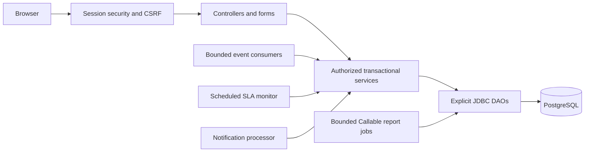

# Architecture and operational handoff

One Java 8 Spring Boot application serves Thymeleaf/Bootstrap pages and uses explicit
JdbcTemplate SQL against PostgreSQL. No JPA/Hibernate, external broker, remote email
service or production deployment is assumed.

Read AGENTS.md, MILESTONES.md and BUILD_PLAN.md first. Domain entrypoints and invariants
are detailed in DATA_ACCESS, AUTHENTICATION, TICKET_WORKFLOW, ASSIGNMENT, LIFECYCLE,
SLA_MONITORING, NOTIFICATIONS_EVENTS, REPORTS and ASSESSMENT documents in this folder.

Customer ownership is derived through telecom_service; current engineer assignment
controls work access. All sensitive operations reload database account roles/profile
and reject stale authentication versions. Rows carry optimistic versions; mutations
lock/recheck current state and update with the expected version. Audit, initial and
changed status history, notifications and relevant metadata commit with the ticket.
Same-status reassignment/priority changes use audit rather than fake history entries.
Immutable records have database guards. Never fabricate old resolution metadata.

SLA policies are immutable versioned rows; priority changes recalculate from original
creation time. Independent response/resolution clocks continue during customer waits.
Escalation levels are once per ticket lifetime and keep explicit prior operational
state. Desk resumption preserves highest escalation and deadlines. V008 only expands
the resolution-code CHECK; V001-V007 are immutable and existing values remain valid.

Background event work and notification state are durable in PostgreSQL. Each worker
uses row locks, unique keys and bounded retries; queue saturation leaves pending work
for recovery. Local notification receipts and event fan-out use savepoints to persist
retry state while rolling back partial business writes. Worker exceptions are generic.
Owned executors start once and close on context shutdown. The SLA monitor, event
consumers and delivery scans are web-only; explicit database tools never start them.

Reports use SQL aggregation and one statement per export. Jobs/bytes are bounded but
process-local; restart loses report jobs, requiring regeneration. Download permissions
include owner, auth version and role path. The report catalog and export formats are
closed enums/factories, not interpolated request SQL or user file paths.

## Explicit scope limits

- OTP delivery is a session-bound development preview. Non-dev delivery is unavailable
  until a real adapter is configured. In-app notifications do not send SMTP/SMS.
- Escalation contact emails remain placeholders until an external delivery integration
  is configured. Managers share escalation-recipient inbox read state.
- Legacy seeded resolved tickets lack structured resolution records and cannot be
  closed through the new flow until real historical data is adopted. Use a fresh ticket
  for the complete demonstration; no reopening or service ownership transfer exists.
- One engineer specialization; no capacity cap. Category/skill configuration has no
  management UI. Node editing/unlinking/deactivation screens are not implemented.
- Event fan-out is atomic per event and may need measured redesign for very large
  mappings. The initial simulator supports OUTAGE and DEGRADATION, mapping an example
  link-down incident to OUTAGE, not an external monitoring protocol.
- Report attribution uses current assignment/state and is not historical workforce
  attribution. Result retention is 30 minutes/process-local, not a durable report store.
- Assessment examples run only through scratch tests. No numeric coverage percentage,
  penetration certification or production readiness claim is made.
- Local Git author identity was not supplied; no invented identity, commit or push.

This repository completes the approved local case-study milestones within those
documented choices. Future work should use additive migrations after V008, keep local
credentials ignored/outside the JAR, and use scratch databases for writable tests.
