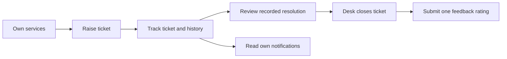
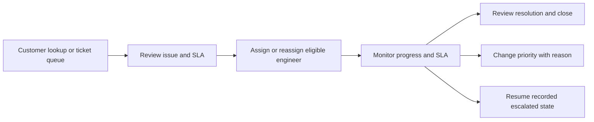

# User workflows and permissions

[Project README](../README.md) · [Documentation index](README.md) · [Sequence diagrams](design/SEQUENCES.md)

## Contents

1. [Shared sign-in and recovery](#shared-sign-in-and-recovery)
2. [Customer workflow](#customer-workflow)
3. [Service desk workflow](#service-desk-workflow)
4. [Network engineer workflow](#network-engineer-workflow)
5. [Network manager workflow](#network-manager-workflow)
6. [Permission matrix](#permission-matrix)
7. [Background workflows](#background-workflows)
8. [Routes and navigation](#routes-and-navigation)

## Shared sign-in and recovery

1. Open `/login` and enter username/password.
2. Answer the addition question displayed on that form. CAPTCHA challenges are
   session-bound, single-use and expire after five minutes.
3. Continue to `/login/otp` and submit the six-digit verification code. With the
   development profile, the code is displayed on this verification page.
4. Successful verification creates the authenticated session and routes to the
   user's workspace. Staff roles take precedence for accounts with multiple roles.
5. For forgotten passwords, use the reset request/OTP/new-password flow. Password
   reset invalidates stale authentication through the account version.

Five failed password attempts lock an account for 15 minutes. OTPs expire after
five minutes and permit five incorrect valid-format attempts. Sign-out requires
CSRF. Existing pending login verification is preserved when revisiting `/login`;
the explicit restart action begins a new attempt.

[Authentication rules and troubleshooting](AUTHENTICATION.md)

## Customer workflow

**Goal:** report a service issue and follow it through closure.

1. View services linked to the current customer profile.
2. Select an active service and enter incident category, description, priority and
   severity. Both service and customer must be active for a new ticket.
3. Submit: the system creates an `OPEN` ticket, calculates SLA deadlines and records
   initial history, a customer notification and audit in the same transaction.
4. Filter own tickets by status/priority; open details for assignment, history,
   response/resolution SLA, remaining time and escalation information.
5. Read notifications and mark them read. Read state does not alter delivery state.
6. After desk closure, submit one rating from 1–5 and optional comments.

The customer can cancel an **own OPEN** ticket with a reason. Customers cannot
assign engineers, change priority after creation, resolve, close or reopen tickets.
Customer-information waiting is managed by the assigned engineer; there is no
separate customer-response portal in this version.

[Intake/tracking](TICKET_WORKFLOW.md) · [Feedback/cancellation](LIFECYCLE.md)

## Service desk workflow

**Goal:** coordinate customer support and keep work progressing.

1. Find a customer by customer number and view services, or open the ticket queue.
2. Raise a ticket on behalf of the actual service owner when needed.
3. Review up to three engineer recommendations. Eligibility requires availability,
   category specialization and matching service region. Ranking uses active workload
   ascending, experience descending, then employee code.
4. Assign the engineer. The first assignment changes `OPEN` to `ASSIGNED`.
5. Reassign eligible active work when necessary, with a reason. A same-status
   reassignment records audit and notifications rather than fake status history.
6. Monitor response/resolution SLA. Changing priority requires a reason and recalculates
   deadlines from original creation time; it does not restart the clock.
7. When a ticket is `ESCALATED`, explicitly resume its saved operational status.
   Assignment/engineer actions wait until that resumption. Unknown prior status blocks
   resumption instead of guessing.
8. Review structured engineer resolution and close a `RESOLVED` ticket.

Desk can cancel unresolved tickets with a reason. Desk also manages node/service
mappings, simulates events in development, reviews failed/unmapped events, monitors
notification processing and generates reports. It cannot mark recipient messages
read through the processing overview.

[Assignment](ASSIGNMENT.md) · [Lifecycle](LIFECYCLE.md) · [SLA](SLA_MONITORING.md) ·
[Events](NOTIFICATIONS_EVENTS.md) · [Reports](REPORTS.md)

## Network engineer workflow

**Goal:** investigate and resolve the incidents currently assigned to the engineer.

1. Open assigned work and filter by status/priority.
2. Acknowledge an `ASSIGNED` ticket. This changes it to `IN_PROGRESS` and records the
   first response once; assignment alone does not count as a response.
3. Investigate. If customer information is needed, enter a reason and move to
   `PENDING_CUSTOMER`. Resume to `IN_PROGRESS` when ready. SLA clocks keep running.
4. Resolve from `IN_PROGRESS` with root cause, resolution text and a controlled code.
   The resolution timestamp and immutable resolution metadata are recorded together.
5. Read notifications for tickets still assigned to this engineer.

Reassignment removes the previous engineer's ticket and inbox access. Engineers do
not close tickets, assign themselves work, change priority or bypass escalation
resumption. Desk handles closure and explicit escalation resumption.

[Actions, required fields and allowed transitions](LIFECYCLE.md)

## Network manager workflow

**Goal:** assess the operation and identify SLA/workload problems.

1. Review global active/open/critical/escalated totals, separate response/resolution
   overdue counts, resolved-today totals and completed-only average resolution time.
2. Review current engineer workload and event failure/unmapped counts.
3. Open SLA monitoring to filter tickets and inspect independent target states.
4. Read the shared management inbox for configured escalation-recipient messages.
5. Request one of seven reports, choose inclusive creation dates and CSV/TXT, refresh
   job status and download after completion.

Manager reporting uses current ticket state and current engineer assignment, not a
historical reconstruction. Jobs are private to their requester, authentication version
and role path. Managers do not acquire desk mutation permissions automatically.

[Dashboard/report definitions](REPORTS.md)

## Permission matrix

“Own” follows the currently linked profile; “assigned” means the current engineer.

| Capability | Customer | Service desk | Engineer | Manager |
|---|---|---|---|---|
| View services / raise tickets | Own services; raise only if active | For actual customer owners | — | — |
| View ticket detail/history | Own | All | Assigned | SLA summary / reports |
| Assign/reassign | — | Eligible active work | — | — |
| Acknowledge / wait / investigate / resolve | — | — | Assigned, allowed state only | — |
| Change priority after creation | — | Unresolved tickets | — | — |
| Resume escalation | — | Recorded prior state only | — | — |
| Close resolved work | — | Structured resolution required | — | — |
| Cancel | Own OPEN ticket | Unresolved tickets | — | — |
| Submit feedback | Own CLOSED ticket, once | — | — | — |
| Inbox mark-read | Own | Processing overview only | Assigned recipient messages | Shared escalation inbox |
| Node mappings / event review | — | Yes; simulator is dev-only | — | — |
| Generate/download reports | — | Own jobs | — | Own jobs |

All mutation forms require CSRF and server-side authorization. Ticket mutations also
use current state and optimistic `row_version`; stale edits return a conflict.

## Background workflows

| Worker | Trigger | Outcome |
|---|---|---|
| SLA monitor | First scan after 60 seconds, then 60-second fixed delay | Evaluate unfinished targets; atomically record each newly due escalation level |
| Notification processor | First scan after 5 seconds, then 5-second fixed delay | Create unique in-app receipt and mark delivery; retry failures up to three attempts |
| Event recovery/consumers | Recovery on startup and every 15 seconds; consumers drain a bounded queue | Create one ticket per eligible mapped event/service pair, or retain work for review/retry |
| Report generator | Authorized staff request | Run bounded SQL and format an owner-protected CSV/TXT export |

Network events are committed before IDs are queued. A full queue leaves recoverable
database work. Event fan-out is atomic; failed later writes remove earlier partial
tickets. Failed/unmapped events can be retried after desk review. Notifications and
events use a 60-second retry delay; notification read state remains independent.

## Routes and navigation

| Role | Useful entry routes |
|---|---|
| Shared | `/login`, `/login/otp`, `/forgot-password`, `/reset-password`, `/dashboard` |
| Customer | `/customer/services`, `/customer/tickets`, `/customer/notifications` |
| Desk | `/service-desk/services`, `/service-desk/queue`, `/service-desk/tickets`, `/service-desk/sla`, `/service-desk/network/events`, `/service-desk/notifications`, `/service-desk/reports` |
| Engineer | `/engineer/tickets`, `/engineer/notifications` |
| Manager | `/manager/sla`, `/manager/notifications`, `/manager/reports` |

Use dashboard links to supply required context, such as customer lookup or ticket IDs.
This is a form-based MVC application; these routes are not a public REST API contract.

For a reproducible multi-role demonstration, follow [DEMO.md](DEMO.md).
