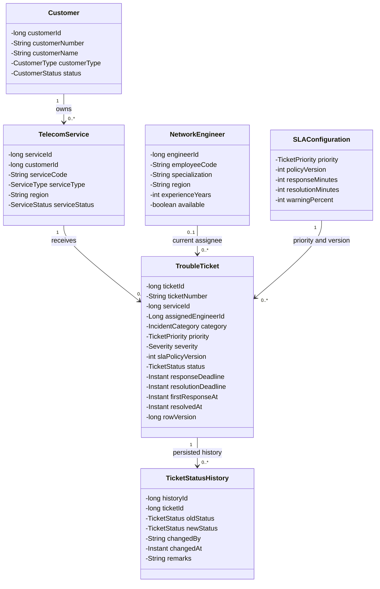
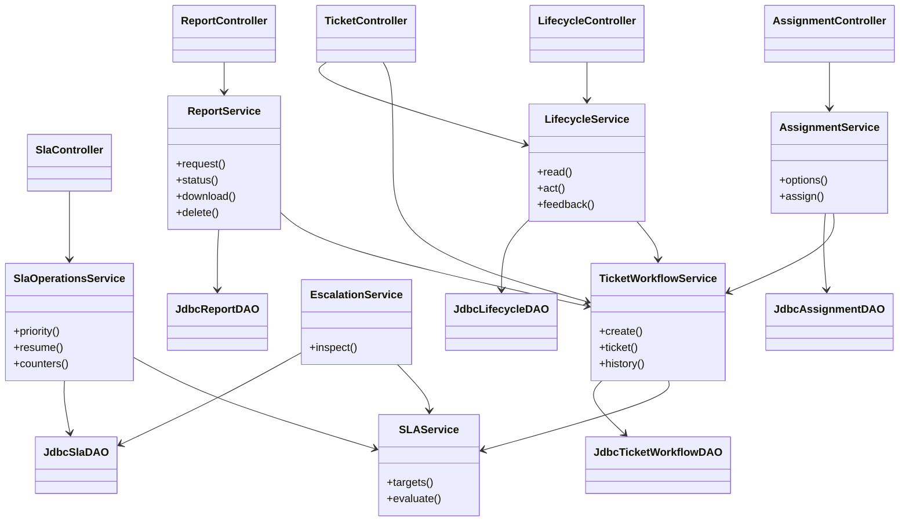
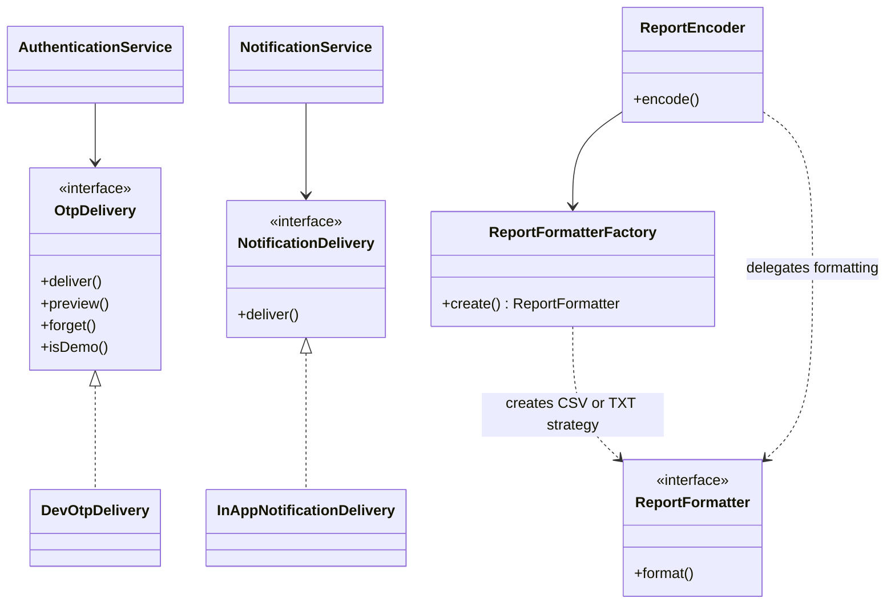

# Class diagrams

[Design index](README.md) · [Database ER diagrams](DATABASE.md) · [Sequences](SEQUENCES.md)

## Contents

1. [Core domain classes](#core-domain-classes)
2. [Application services](#application-services)
3. [Formatting and delivery interfaces](#formatting-and-delivery-interfaces)
4. [Reading the diagrams](#reading-the-diagrams)

## Core domain classes

These six classes are immutable Java persistence snapshots. The diagram selects
important fields; constructors/getters and other profile fields are omitted.
Associations describe persisted relationships through IDs, not object-reference
navigation or ORM mappings.

Workload is derived from active assigned tickets, not stored as a mutable field on
`NetworkEngineer`. Customer ownership is derived through `TelecomService`.

## Application services

The classes and method names below exist in the source. Parameters and less relevant
dependencies are omitted to keep the diagram readable. Arrows represent dependencies.

`TicketWorkflowService` also centralizes current-account/profile authorization used
by related services. `NetworkEventService` invokes its internal system-ticket creation
method within the event transaction; it does not impersonate a desk session.

## Formatting and delivery interfaces

The non-development OTP fallback is a configured lambda that reports delivery
unavailable. CSV/TXT strategies are produced as implementations of the functional
`ReportFormatter` interface; no separate named CSV/TXT implementation classes are
invented here.

## Reading the diagrams

- Domain enums control priorities, statuses, service types, categories and resolution codes.
- Database entities such as notification/event/audit records are not all separate
  Java model classes: several JDBC APIs use bounded map projections. Their tables
  appear in the [ER diagrams](DATABASE.md), not as fictional Java classes.
- Read DAO interfaces and row mappers are described in [DATA_ACCESS.md](../DATA_ACCESS.md).
- Transaction boundaries and worker coordination appear in the [sequence diagrams](SEQUENCES.md).
- Concrete pattern/Java requirement evidence is indexed in [ASSESSMENT.md](../ASSESSMENT.md).
