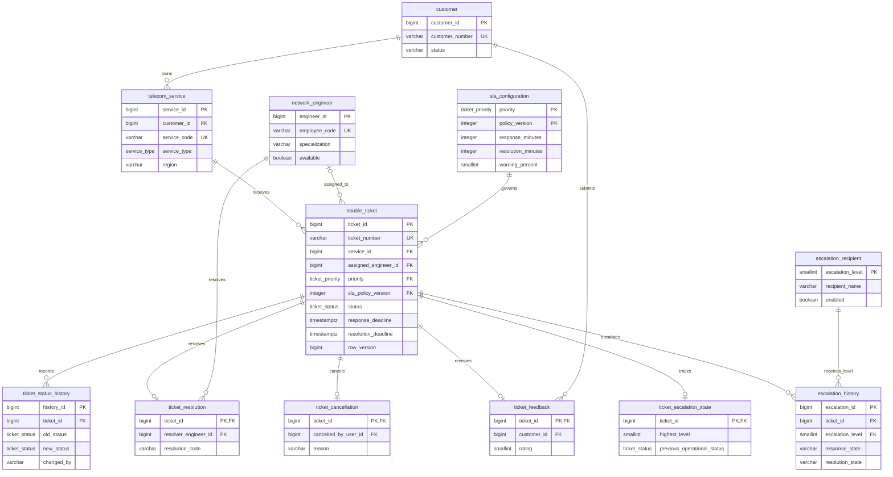
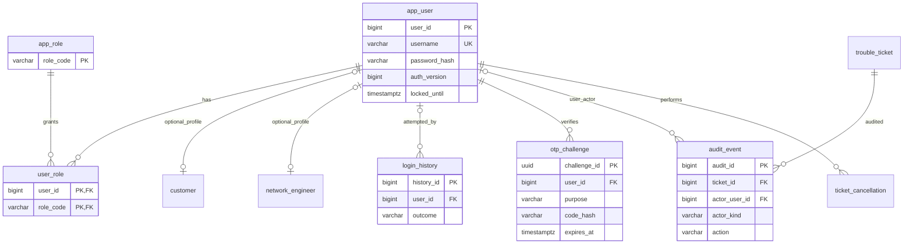
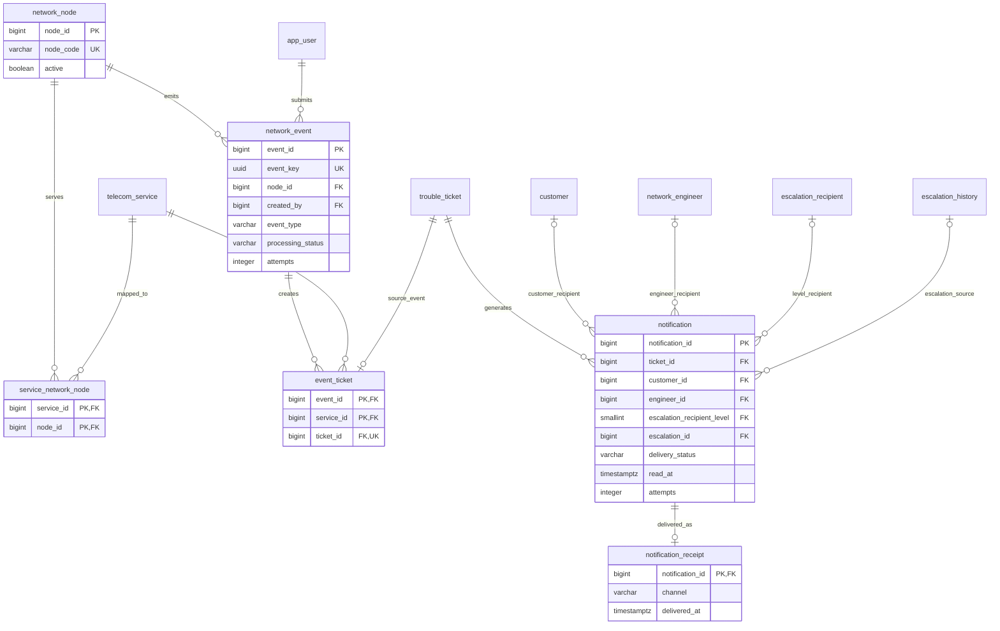

# Database design and ER diagrams

[Design index](README.md) · [Class diagrams](CLASS_DIAGRAMS.md) · [Database setup](../../db/README.md)

## Contents

1. [Core ticket and SLA relationships](#core-ticket-and-sla-relationships)
2. [Authentication and audit](#authentication-and-audit)
3. [Network events and notifications](#network-events-and-notifications)
4. [Integrity and indexing](#integrity-and-indexing)
5. [Migration inventory](#migration-inventory)

The diagrams use physical table names and selected keys/fields. They are split by
concern for readability; repeated entities refer to the same tables. The complete
DDL lives in [versioned migrations](../../db/migrations/).

## Core ticket and SLA relationships

- A ticket belongs to one service; its customer is derived through that service.
- Engineer assignment is optional until the workflow requires it. The recorded
  resolver remains separate from the current assignment.
- `(priority, sla_policy_version)` references the composite SLA policy key
  `(priority, policy_version)`.
- Resolution, cancellation, feedback and escalation state use ticket ID as their
  primary key, allowing at most one of each record per ticket.
- Escalation history is unique by `(ticket_id, escalation_level)`. Previous operational
  status is explicit; it is not inferred from the ticket's current `ESCALATED` label.
- History `changed_by` is a stable actor string, not a user foreign key. Services
  create the initial history entry atomically with the ticket.

## Authentication and audit

Customer and engineer `user_id` links are nullable and unique: profiles can exist
without a login. Login history may have no matched account. `USER` audit records
require `actor_user_id`; `SYSTEM` records require it to be null. Service-desk and
manager access comes from roles, not fabricated customer/engineer profiles.

## Network events and notifications

- Services and nodes are many-to-many through `service_network_node`.
- A UUID event key deduplicates simulator submissions. `(event_id, service_id)`
  prevents duplicate tickets for the same affected service/event. Unique ticket ID
  permits at most one source-event association per ticket.
- A composite foreign key also ensures the associated ticket belongs to the stored service.
- Each notification has **exactly one** customer, engineer or configured escalation-level
  recipient. The three optional diagram edges express alternatives, not three recipients
  on the same row.
- A receipt is unique per notification; `read_at` remains separate from delivery status.

`category_specialization` configures category-to-skill rules using controlled incident
categories. `schema_migration` is the technical version/checksum ledger. They are
omitted from the relationship views because they are not ticket ownership links.
Report jobs are in-memory, so there is no report-job table.

## Integrity and indexing

| Mechanism | Examples |
|---|---|
| Business uniqueness | Customer number, service code, employee code, ticket number, username and event key |
| Controlled values | PostgreSQL priority/status/service/category enums; CHECK catalogs for lifecycle/delivery/event values |
| Append-only guards | Status history, SLA policies, audit, resolution/cancellation/feedback, escalation history, event associations and delivery receipts |
| Access/list indexes | Customer services, engineer/status tickets, chronological ticket/history views and role links |
| Due-work indexes | Unanswered response deadlines, active resolution deadlines, pending notifications and pending events |
| Replay protection | Event/service uniqueness, one initial ticket-history row, one creation notification and escalation recipient uniqueness |
| Concurrency | `FOR UPDATE`, ordered engineer locks, `SKIP LOCKED` worker reads and optimistic `row_version` predicates |

Business transitions and history continuity are enforced by services/transactions;
the schema does not automatically execute the entire workflow or calculate deadlines.

## Migration inventory

| Version | Change |
|---|---|
| [V001](../../db/migrations/V001__initial_schema.sql) | Six core entities, enums, indexes and history/SLA guards |
| [V002](../../db/migrations/V002__authentication.sql) | Users, roles, login history, OTP challenges and profile links |
| [V003](../../db/migrations/V003__ticket_intake.sql) | Notification/audit foundation and ticket-number sequence |
| [V004](../../db/migrations/V004__engineer_assignment.sql) | Skill rules, engineer notification recipients and assignment audit |
| [V005](../../db/migrations/V005__manual_lifecycle.sql) | Resolution, cancellation and feedback metadata |
| [V006](../../db/migrations/V006__sla_escalation.sql) | Escalation state/history/recipients and SYSTEM audit actors |
| [V007](../../db/migrations/V007__notifications_network_events.sql) | Delivery receipts/retries, nodes, mappings, events and ticket associations |
| [V008](../../db/migrations/V008__case_study_resolution_codes.sql) | Additional case-study resolution codes with historical compatibility |

Applied migrations are immutable. The explicit runner validates SHA-256 checksums
and a contiguous ledger before applying pending versions transactionally. Setup
refuses a populated schema; application startup does not migrate. Future schema
changes begin at V009. See [migration policy](../../db/migrations/README.md).
