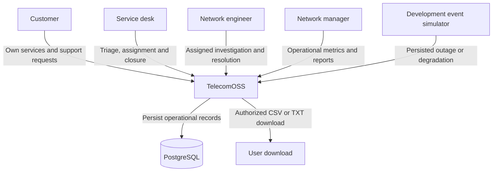
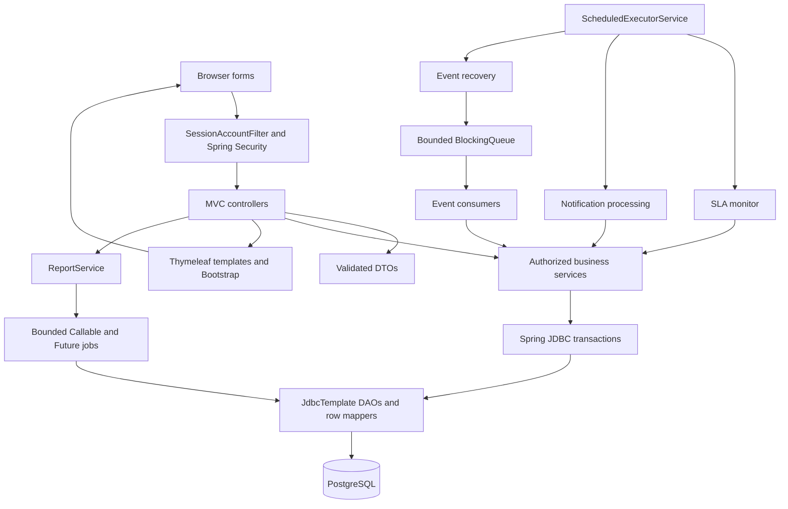
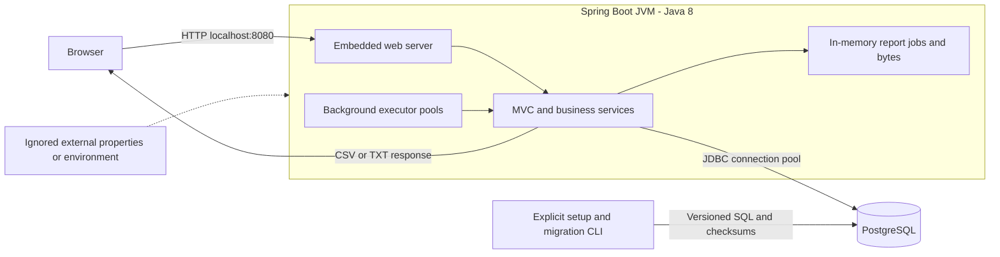

# System design

[Project README](../../README.md) · [Documentation index](../README.md)

## Contents

1. [Diagram index](#diagram-index)
2. [System context](#system-context)
3. [Layered architecture](#layered-architecture)
4. [Local deployment](#local-deployment)
5. [Key design decisions](#key-design-decisions)

## Diagram index

| View | What it explains |
|---|---|
| [System context](#system-context) | Users and the system boundary |
| [Layered architecture](#layered-architecture) | MVC, services, SQL and worker responsibilities |
| [Local deployment](#local-deployment) | Browser, JVM, PostgreSQL and local configuration |
| [Class diagrams](CLASS_DIAGRAMS.md) | Actual domain classes, service dependencies and interfaces |
| [ER diagrams](DATABASE.md) | Core, security, lifecycle, notification and network-event relationships |
| [State/sequence diagrams](SEQUENCES.md) | Ticket states, login, atomic writes, recovery and asynchronous exports |

## System context

The simulator is part of the application, exposed only to authorized desk users in
the development profile. There is no external monitoring platform, broker, SMTP or
SMS integration in the current deployment. Notifications are delivered in-app.

## Layered architecture

| Layer | Responsibility |
|---|---|
| Controllers | Form binding, validation feedback, view models, redirects and authorized downloads |
| Services | Current-role/ownership checks, business rules, lock/version checks and transaction boundaries |
| DAOs/mappers | Explicit bound SQL, PostgreSQL enum conversion, UTC timestamp mapping and bounded reads |
| Database | Keys, foreign keys, unique/CHECK constraints, indexes, row locking and immutable-record guards |
| Background workers | Scheduling/queue management, persisted recovery, per-job failure isolation and executor shutdown |
| Templates | Escaped rendering, CSRF forms and role-appropriate navigation |

Report generation is read-only; the report service performs role checks and executes
bounded aggregate queries. It does not use the ticket mutation transaction flow.

## Local deployment

The IntelliJ run configuration, Maven run and runnable JAR all start the same
application. Run from the repository root so external configuration and explicit
migration paths resolve correctly. Normal startup does not migrate the schema.

Tickets, histories, events, notifications and receipts are database-backed. Report
jobs/results and the development OTP delivery preview are process-local. Event queues
are also process-local, but pending event work is recovered from PostgreSQL. Multiple
instances are therefore not interchangeable for a report job or development login.

## Key design decisions

| Decision | Reason and consequence |
|---|---|
| One modular monolith | Keeps transactions and local demonstration straightforward |
| Explicit JDBC rather than an ORM | Makes SQL, mapping, locking and transaction behavior visible |
| Customer derived through service | Avoids duplicating ticket customer ownership |
| Immutable SLA versions | Old tickets retain the policy selected at creation/priority change |
| Row locks plus optimistic versions | Saves recheck eligibility and reject stale browser forms |
| History plus audit | Status changes have history; same-status operations retain audit without invalid history rows |
| Durable work before queueing | Queue overflow/restart can recover events without duplicate incident tickets |
| Separate notification read/delivery state | Reading does not falsely indicate successful processing |
| Bounded background work | Limits queue size, retries, report retention and export memory |

See [operational invariants and scope limits](../ARCHITECTURE.md) for the full handoff.
