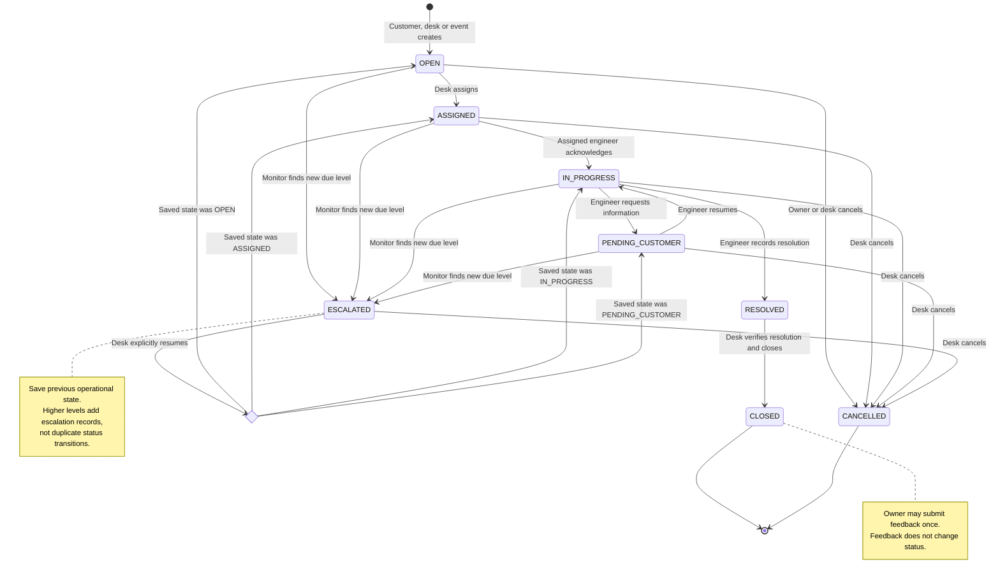
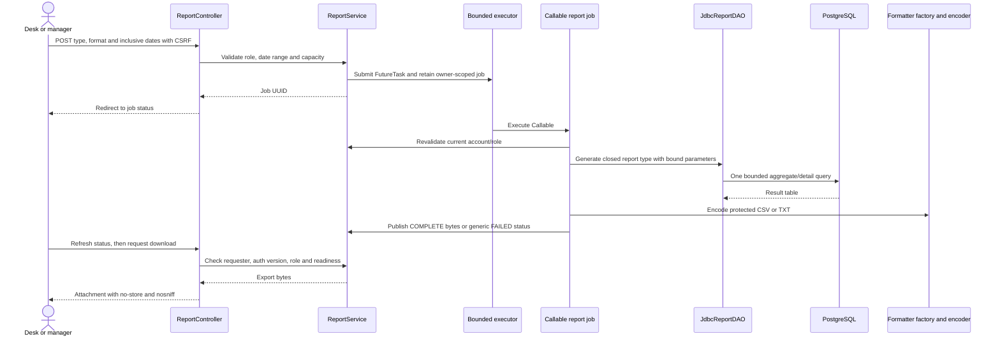

# State and sequence diagrams

[Design index](README.md) · [Role workflows](../WORKFLOWS.md) · [Class diagrams](CLASS_DIAGRAMS.md)

## Contents

1. [Ticket state machine](#ticket-state-machine)
2. [Password, CAPTCHA and OTP login](#password-captcha-and-otp-login)
3. [Transactional ticket creation](#transactional-ticket-creation)
4. [Engineer assignment](#engineer-assignment)
5. [Network-event processing and recovery](#network-event-processing-and-recovery)
6. [Asynchronous report generation](#asynchronous-report-generation)

These are behavioral views of the current implementation. Arrows group related DAO
calls where showing every SQL statement would obscure the transaction boundary.

## Ticket state machine



`Restore` is a diagram decision node, not a database status. The stored prior state
determines exactly one outcome. Missing prior state blocks resumption. There is no
reopening, direct engineer resolution from `ESCALATED`, or cancellation after resolution.
Reassignment and priority changes do not create fake same-status history entries.

[Lifecycle policy](../LIFECYCLE.md) · [Escalation/resumption](../SLA_MONITORING.md)

## Password, CAPTCHA and OTP login

```mermaid
sequenceDiagram
    actor User
    participant Web as AuthenticationController
    participant Captcha as CaptchaService
    participant Auth as AuthenticationService
    participant DB as Authentication JDBC and PostgreSQL
    participant OTP as OtpDelivery
    User->>Web: GET login
    Web->>Captcha: Issue independent session-bound challenge
    Web-->>User: Password and CAPTCHA form
    User->>Web: POST credentials, challenge ID and answer
    Web->>Captcha: Consume and validate challenge
    alt Invalid or expired CAPTCHA
        Web->>Auth: Record CAPTCHA failure
        Web-->>User: New challenge and safe feedback
    else Valid CAPTCHA
        Web->>Auth: beginLogin()
        Auth->>DB: Lock and load account, roles and password hash
        Auth->>Auth: Check account/lock state and BCrypt password
        alt Password and account accepted
            Auth->>DB: Store hashed OTP challenge with session binding and expiry
            Auth->>OTP: Deliver session-bound verification code
            Auth-->>Web: Pending challenge
            Web-->>User: Verification page; preview shown only in dev
            User->>Web: POST six-digit code in same session
            Web->>Auth: completeLogin()
            Auth->>DB: Verify and consume challenge; record success atomically
            Auth-->>Web: TelecomPrincipal without password/hash
            Web-->>User: Rotate session ID and redirect to role workspace
        else Password rejected or account unavailable
            Auth->>DB: Record outcome and update applicable failure counters
            Web-->>User: Safe sign-in failure
        end
    end
```

CAPTCHA and OTP are single-use. OTP failure/expiry, account locking and reset details
are covered in [AUTHENTICATION.md](../AUTHENTICATION.md). Non-development OTP delivery
is unavailable until an external adapter is configured.

## Transactional ticket creation

```mermaid
sequenceDiagram
    actor User as Customer or service desk
    participant Web as TicketController
    participant Service as TicketWorkflowService
    participant SLA as SLAService
    participant DB as JDBC DAOs and PostgreSQL
    User->>Web: Submit validated ticket form with CSRF
    Web->>Service: create(principal, scope, form)
    Note over Service,DB: One Spring-managed JDBC transaction
    Service->>DB: Reload actor; lock service and owner; verify active state/ownership
    Service->>SLA: Select latest immutable priority policy and targets
    Service->>DB: Insert OPEN ticket using generated display sequence
    Service->>DB: Insert initial status history
    Service->>DB: Insert customer notification and user audit
    alt All writes succeed
        Service->>DB: COMMIT
        Service-->>Web: Ticket ID
        Web-->>User: Redirect to authorized ticket detail
    else Validation or any write fails
        Service->>DB: ROLLBACK all ticket-related writes
        Web-->>User: Safe validation, conflict or unavailable response
    end
```

Sequence gaps after rollback are allowed. The server derives ownership and actor
identity; posted customer/actor IDs cannot override them. Event creation reuses an
internal service method with explicit SYSTEM provenance.

## Engineer assignment

```mermaid
sequenceDiagram
    actor Desk as Service desk
    participant Web as AssignmentController
    participant Service as AssignmentService
    participant DB as Assignment JDBC and PostgreSQL
    Desk->>Web: Open assignment form
    Web->>Service: options()
    Service->>DB: Read ticket, category skill and eligible ranked engineers
    Service-->>Desk: Up to three recommendations and row version
    Desk->>Web: Submit engineer, version and applicable reason
    Web->>Service: assign()
    Note over Service,DB: One transaction; recommendations are rechecked
    Service->>DB: Lock current actor and ticket; compare version
    Service->>DB: Lock service, skill rule and engineers in stable order
    Service->>DB: Recheck skill, region, availability and different assignee
    Service->>DB: Update assignee and optimistic version
    opt First assignment from OPEN
        Service->>DB: Change to ASSIGNED and append status history
    end
    Service->>DB: Insert customer/engineer notifications and assignment audit
    alt All writes succeed
        Service->>DB: COMMIT
        Web-->>Desk: Updated ticket
    else Stale version, ineligible engineer or failed write
        Service->>DB: ROLLBACK
        Web-->>Desk: Conflict or safe error; refresh recommendations
    end
```

Assignment never sets `first_response_at`. That occurs when the current engineer
acknowledges. Same-status reassignment requires a reason and creates audit, not an
invalid repeated status-history transition.

## Network-event processing and recovery

```mermaid
sequenceDiagram
    actor Desk as Service desk in dev
    participant Web as Simulator controller
    participant Event as NetworkEventService
    participant Queue as EventDispatcher queue
    participant Recovery as Scheduled recovery
    participant Worker as Event consumer
    participant Tickets as TicketWorkflowService
    participant DB as PostgreSQL
    Desk->>Web: Submit node, type, description and UUID key
    Web->>Event: simulate()
    Event->>DB: Persist deduplicated event and COMMIT
    Event-->>Web: Event ID
    Web->>Queue: Offer event ID after commit
    Note over Queue,DB: Full queue leaves pending work in the database
    Web-->>Desk: Event detail
    Recovery->>DB: Read due pending work on startup and every 15 seconds
    Recovery->>Queue: Re-enqueue recoverable IDs
    Worker->>Queue: Poll event ID
    Worker->>Event: process(id)
    Event->>DB: Lock due event with SKIP LOCKED; record attempt
    Note over Event,DB: Savepoint encloses all business fan-out writes
    Event->>DB: Shared node lock stabilizes mappings
    loop Mapped service IDs in ascending pages
        Event->>Tickets: Internal system-ticket creation for eligible service
        Tickets->>DB: Ticket, initial history, notification and SYSTEM audit
        Event->>DB: Insert unique event/service/ticket association
    end
    alt All business writes succeed
        Event->>DB: Set PROCESSED or UNMAPPED; COMMIT
    else Any business write fails
        Event->>DB: Roll back to savepoint; remove partial tickets/side effects
        Event->>DB: Persist retry or terminal FAILED state; COMMIT
    end
```

Two consumers share a bounded 256-ID queue. Database locks and event/service
uniqueness protect overlap across app instances. A later-service failure rolls back
earlier creations in that event. Unmapped events remain for desk review; retries are
bounded and recoverable. See [NOTIFICATIONS_EVENTS.md](../NOTIFICATIONS_EVENTS.md).

## Asynchronous report generation



The worker's role revalidation is performed inside `ReportService`; it is drawn as a
logical step, not a public callback endpoint. Other users cannot access the job.
Restart clears process-local jobs/results; expired or evicted jobs must be regenerated.
See [REPORTS.md](../REPORTS.md) for limits and metric definitions.
